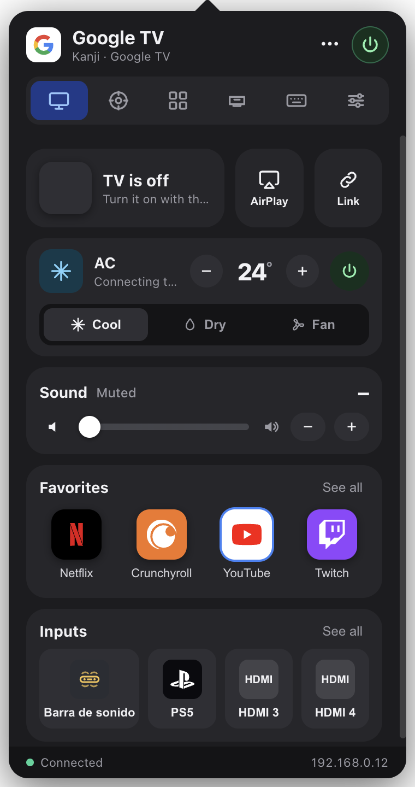

# Couch Control

A menu bar (macOS) / tray (Windows) control center for a **Google TV / Android TV** and an **air conditioner driven by a Broadlink IR blaster**. One compact panel, iOS-Control-Center style: what's on screen with playback controls, Cast and AirPlay shortcuts, volume in sound bar units, favorite apps, HDMI inputs with device logos, and an AC tile with temperature, power and mode.

<p align="center"></p>

## Features

**TV (Android TV Remote v2 protocol, no root, no cloud)**
- One-time pairing with the code shown on the TV; the certificate is stored locally.
- Power, volume, mute, d-pad, media keys, numbers, text input and clipboard paste.
- Launch apps by deep link (Netflix, YouTube, Crunchyroll, Twitch, Disney+, Prime Video, Spotify…), and any other app through ADB (optional).
- Content shortcuts: save a show/video URL and open it directly on the TV.
- HDMI inputs with custom names and device logos (PlayStation, Xbox, Switch, Apple TV, sound bar…).
- "Now" tile with the app on screen, play/pause that follows the real state, and a timeline for apps that report progress (YouTube, Spotify).
- Background mini player for Cast sessions that are not on screen (e.g. Spotify Connect while you play on a console).
- Menu bar icon shows the logo of the app on screen (or the console on the active HDMI).

**Google Cast**
- Exact volume control, mute, and media control of Cast sessions (play/pause, seek, next/previous).
- Send a video/audio/image URL or a local file (served over the LAN) to the TV.

**Air conditioner (Broadlink RM / RM4)**
- Learn the IR codes of your remote per mode, temperature and fan speed, then control everything from the panel.
- Compact tile: temperature ±, power, and Cool / Dry / Fan modes.

**Other**
- English and Spanish UI (follows the system language; selectable in Settings).
- Sound bar mode: shows and steps the volume in sound bar units (e.g. TV 3 = bar 1).
- Lightweight: ~120 MB of RAM and 0% CPU when idle (Electron, GPU process included).

## Install

Download the latest release for macOS (`.dmg`) or Windows (`.exe`) from the [Releases](https://github.com/rusherdv/couch-control/releases) page.

> The builds are not code-signed. On macOS, right-click the app → Open the first time (or run `xattr -dr com.apple.quarantine "/Applications/Couch Control.app"`). On Windows, SmartScreen → More info → Run anyway.

### Run from source

```bash
git clone https://github.com/rusherdv/couch-control.git
cd couch-control
npm install
npm run setup:adb   # optional: downloads adb (platform-tools) for launching apps without deep links
npm start
```

`npm run dev` keeps the panel open, prints state changes and exposes a local control endpoint on `127.0.0.1:47123` (`/state`, `/key?name=HOME`, `/app?link=…`, `/shot?tab=home&path=…`).

### Build installers

```bash
npm run dist:mac   # dmg + zip (arm64 and x64)
npm run dist:win   # NSIS installer + portable exe
```

The GitHub Actions workflow builds both platforms on every push and attaches the artifacts to tagged releases (`v*`).

## Setup

1. **TV**: Settings → TV IP address (TV: Settings → Network & Internet). Press *Save and connect*; the TV shows a 6-character code once. Enter it and you're paired.
2. **HDMI inputs**: name each port and pick a device type to get its logo. If the HDMI buttons appear shifted on your TV, use *HDMI order correction*.
3. **Sound bar**: if the TV volume steps in multiples of the sound bar's units, enable *Sound bar connected* and set the ratio.
4. **ADB (optional)**: needed only for apps without a deep link (Stremio, Kick, AirPlay Server). On the TV enable Developer options → USB/Network debugging, then enable *Launch apps via ADB* in Settings and accept the prompt on the TV. Packages are auto-detected.
5. **Air conditioner**: the Broadlink is discovered automatically (unlock it in the Broadlink app if the panel says it is locked). In Settings → Air conditioner, choose a mode and fan speed, then *Learn all in sequence*: press each temperature on your AC remote while pointing it at the Broadlink. Learn *Off* too. Repeat for other modes you use.

## How it works

| Component | Protocol / library |
|---|---|
| TV remote, pairing, app links, state (power, volume, foreground app) | Android TV Remote v2 (TLS + protobuf) via [`@kud/androidtv-remote`](https://github.com/kud/androidtv-remote) |
| Exact volume, Cast sessions, media status, casting URLs/files | Google Cast v2 via [`castv2-client`](https://github.com/thibauts/node-castv2-client) |
| HDMI switching | Android TV input passthrough URIs (`content://android.media.tv/passthrough/…`) sent as app links |
| Apps without deep links, package detection | ADB over the network (`adb connect`, `monkey`, `pm list packages`) |
| Air conditioner | Broadlink RM protocol via [`node-broadlink`](https://github.com/ThomasRaz/node-broadlink) (learn / send IR) |

The TV only reports the foreground package, so playback state and progress come from the app's Cast session when it exposes one (YouTube and Spotify do; Netflix does not). HDMI passthrough ids are MediaTek-specific (`HW4…HW7`); other chipsets may need a different base, which is why it is configurable.

Everything stays on your LAN: no accounts, no telemetry. Settings and the TV certificate live in the app's user data folder (`~/Library/Application Support/Couch Control` on macOS, `%APPDATA%\Couch Control` on Windows).

## Project layout

```
main.mjs          Electron main process: tray, window, config, IPC, TV connection
cast.mjs          Google Cast sender (status, media control, URL/file casting)
adb.mjs           Optional ADB bridge (launch apps, list packages)
ac.mjs            Broadlink RM: discovery, IR learning, sending
preload.cjs       Context bridge exposed to the renderer
renderer/         UI (plain HTML/CSS/JS, no framework)
shared/           Key codes, app/device catalog, i18n dictionaries
assets/           Brand logos (SVG), tray icons (PNG)
tools/            Generators for tray icons and the app icon
scripts/          setup-adb.mjs (downloads platform-tools)
```

## Contributing

Issues and pull requests are welcome. If your TV uses another chipset and HDMI switching needs different ids, or an app needs a different deep link, open an issue with what `npm run dev` logs when you switch inputs or open the app on the TV.

## License

[MIT](LICENSE)
